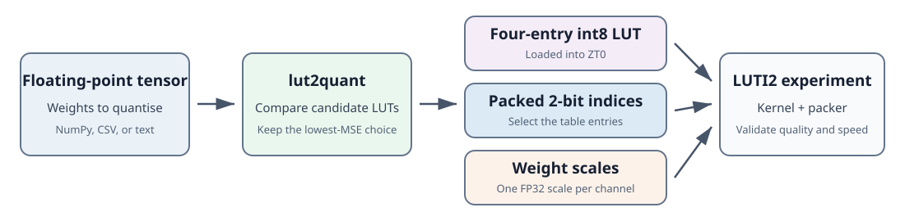
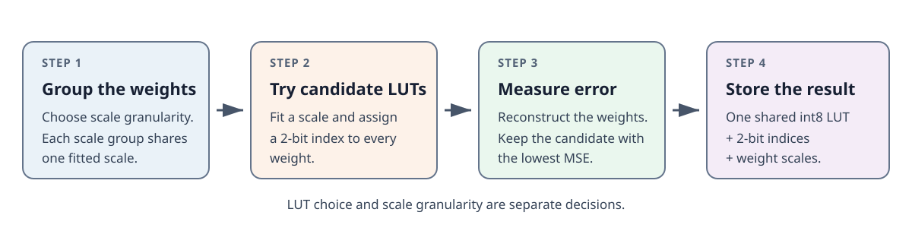
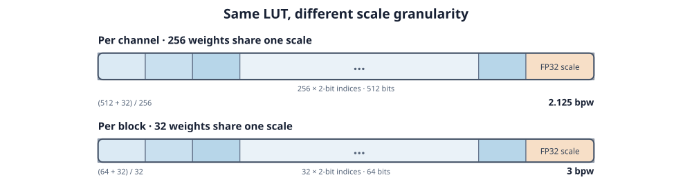
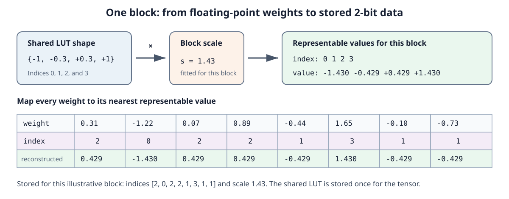

<!--
    SPDX-FileCopyrightText: Copyright 2026 Arm Limited and/or its affiliates <open-source-office@arm.com>

    SPDX-License-Identifier: Apache-2.0
-->

# Choosing a LUT for 2-bit Weight Quantisation

This tutorial shows how to use `lut2quant` to choose a four-value lookup table
(LUT) for a floating-point weight tensor and evaluate a LUT-based 2-bit format.

By the end, you will be able to:

- recommend one shared LUT for a tensor;
- compare it with the arithmetic `int2-grid` baseline;
- understand how LUT choice and scale granularity are separate decisions;
- compare accuracy only at an appropriate storage cost; and
- export reference indices, LUT values, and integration fixtures.

The tool measures weight reconstruction error. It does not measure model
quality or kernel performance, so Section 10 explains what still needs to be
validated before adopting a format.

## 1. The practical problem

A 2-bit index has four possible values: 0, 1, 2, and 3. Quantisation assigns
each floating-point weight to one of four reconstruction values. Those four
values form the codebook, or LUT.

The choice of reconstruction values matters because real weights are rarely
spread evenly. If most weights cluster near zero, using more of the four values
near zero can reduce error. If the weights are skewed to one side, a symmetric
LUT may waste useful levels. There is no single LUT that is best for every
tensor.

The practical question is therefore:

> Given a tensor and a storage/runtime budget, which four-value codebook
> strategy should you consider?

`lut2quant` identifies the best candidate by trying several LUTs and measuring
how accurately each reconstructs the supplied weights. Based on the reported
storage cost and intended kernel design, you can then decide whether the gain
is practical for deployment.

### 1.1 How this relates to LUTI2

A conventional signed 2-bit format gives its four indices a fixed arithmetic
meaning. LUTI2 instead allows a 2-bit index to select one of four int8 values
from a lookup table held in ZT0, the lookup-table register provided by Arm®
Scalable Matrix Extension 2 (SME2). This makes the placement of those four
values a useful design choice rather than a fixed property of the integer
format.

`lut2quant` makes that choice from the supplied tensor. It emits the selected
four-entry int8 table, packed 2-bit indices, and weight scales needed for a
reference experiment. A compatible packer and LUTI2 kernel must still decide
how these values are laid out and used in computation.



*Figure 1. `lut2quant` selects the table and produces a reference
representation; the target LUTI2 integration supplies the packer and kernel.*

## 2. How 2-bit LUT quantisation fits together

The `lut2quant` recommendation workflow is shown below before we examine one
scale group in detail.



*Figure 2. The recommendation workflow divides a tensor into scale groups, evaluates
candidate LUTs, and stores the selected representation.*

There are two separate choices to make:

1. **Which LUT should the tensor use?** The LUT determines the relative
   spacing of the four reconstruction values. The main workflow chooses one
   LUT and shares it across the tensor.
2. **Which weights should share a scale?** The weight scale determines the
   magnitude of those values. This is the scale granularity.

Changing the scale granularity does not change what LUTI2 does. Every weight
still stores a 2-bit index; LUTI2 expands that index to an integer LUT value,
and the kernel applies the weight scale during dequantisation.

The following terms describe the parts of this representation.

| term | meaning |
|---|---|
| tensor | the floating-point weight array being quantised |
| scale group | the weights that share one weight scale |
| 2-bit index | a value from 0 to 3 selecting one of four LUT entries |
| codebook / LUT | the four values available to reconstruct a weight |
| weight scale | a multiplier that adapts the shared integer LUT to one tensor, channel, or block |
| MSE | mean squared reconstruction error; lower is better |
| SNR | reconstruction accuracy relative to weight variance, in dB; higher is better |
| bpw | stored bits per weight, including metadata |
| `int2-grid` | the arithmetic signed 2-bit baseline, with the shape `[-2, -1, 0, +1]` |
| shared LUT | one four-entry table used across the tensor |

Common scale granularities are:

| granularity | what shares one scale | advantage | trade-off |
|---|---|---|---|
| per tensor | the complete tensor | least metadata | one scale must cover every channel and outlier |
| per channel | one output channel (one row of a typical weight matrix) | adapts to channel-to-channel variation | one scale per channel |
| per block | a short run within a channel | adapts to more local variation | more scale metadata and packing complexity |

The reference Arm® KleidiAI™ qsu2cxp packer and kernel path uses one FP32 (32-bit
floating-point) scale per output channel of the right-hand-side (RHS) weight
matrix. This tutorial therefore uses channelwise FP32 scaling for its main
run. For a matrix with `K` weights per channel, its nominal cost is:

$$2 + \frac{32}{K}\text{ bits per weight}.$$

For the generated example, `K = 256`, so the indices cost 2 bpw and the FP32
channel scale costs $32/256 = 0.125$ bpw: **2.125 bpw** in total. With a
32-weight block, the same FP32 scale costs $32/32 = 1$ bpw, giving **3 bpw**.
The once-per-tensor four-byte LUT is small and is not included in these nominal
figures.

FP16 (16-bit floating-point) scales are another possible format choice.
Replacing each 32-bit scale
with a 16-bit scale changes the metadata term from $32/K$ to $16/K$. The
generated example would therefore cost $2 + 16/256 = 2.0625$ bpw, and a
32-weight block would cost 2.5 bpw. This saves storage and bandwidth, but it is
not the scale type consumed by the reference qsu2cxp path: an integration
would need to convert the scale or use a kernel designed for FP16 scales. FP16
rounding can also slightly change reconstruction accuracy, so it should be
included when evaluating such a format.



*Figure 3. Smaller scale groups can improve local accuracy, but repeat the
FP32 scale more often. LUT choice remains a separate, tensor-wide decision.*

## 3. Worked example: quantising one scale group

This example uses eight weights so that every step fits on the page. The tool
can represent a channel, a block within a channel, or the whole tensor; the
mapping process is the same.

Our floating-point scale group is:

```text
w = [0.31, -1.22, 0.07, 0.89, -0.44, 1.65, -0.10, -0.73]
```

### 3.1 Choose a candidate LUT

Start with the symmetric four-entry LUT:

```text
c = [-1, -0.3, +0.3, +1]
```

These are shape values, not yet the integer LUT values used by a kernel. An
index of 0 selects `-1`, index 1 selects `-0.3`, index 2 selects `+0.3`, and
index 3 selects `+1`.

This LUT is non-uniform: the gap between its two inner values is smaller than
the outer gaps. It therefore places relatively more resolution near zero,
where many weight tensors contain most of their values.

### 3.2 Fit the weight scale

The scale and the index assignments must be fitted together. Changing the
scale moves all four reconstruction values, which can change the nearest LUT
entry for a weight. Changing an assignment, in turn, changes the scale that
best reconstructs the group.

The tool starts with an initial scale and repeats two simple steps:

1. assign each weight to its nearest scaled LUT entry; and
2. keeping those assignments fixed, choose the scale that minimises their
   total squared reconstruction error.

For fixed assignments, that second step has the direct solution

$$s = \frac{\sum_i w_i q_i}{\sum_i q_i^2},$$

where $w_i$ is an original weight and $q_i$ is its assigned, unscaled LUT
entry. The tool repeats the two steps until another pass no longer changes the
assignments.

For this example, the final assignments use the LUT entries
`[+0.3, -1, +0.3, +0.3, -0.3, +1, -0.3, -0.3]`. Substituting the weights and
these entries into the expression above gives approximately:

```text
s = sum(weight × assigned LUT entry) / sum(assigned LUT entry²)
  = 3.632 / 2.54
  = 1.43
```

Multiplying every LUT entry by the scale produces the only four values that
this scale group can reconstruct:

| index | LUT entry | scaled reconstruction value |
|---:|---:|---:|
| 0 | -1.0 | -1.430 |
| 1 | -0.3 | -0.429 |
| 2 | +0.3 | +0.429 |
| 3 | +1.0 | +1.430 |

### 3.3 Assign a 2-bit index to each weight

Each floating-point weight is replaced by the index of its nearest scaled
value:

| original weight | nearest value | stored index | error: original - reconstructed |
|---:|---:|---:|---:|
| +0.31 | +0.429 | 2 | -0.119 |
| -1.22 | -1.430 | 0 | +0.210 |
| +0.07 | +0.429 | 2 | -0.359 |
| +0.89 | +0.429 | 2 | +0.461 |
| -0.44 | -0.429 | 1 | -0.011 |
| +1.65 | +1.430 | 3 | +0.220 |
| -0.10 | -0.429 | 1 | +0.329 |
| -0.73 | -0.429 | 1 | -0.301 |



*Figure 4. A shared LUT and fitted weight scale produce four reconstruction
values; each original weight is represented by the nearest value's index.*

### 3.4 Put the same calculation in kernel form

The normalised LUT made the arithmetic easy to follow. For LUTI2, the same
shape is represented by the integer table `[-127, -38, 38, 127]`. The tool
fits the weight scale against those integers, so the scale stored for this
group is approximately `0.01127`, not `1.43`:

```text
int8 LUT     = [-127, -38, 38, 127]   # shared across the tensor
indices      = [2, 0, 2, 2, 1, 3, 1, 1]
weight scale = 0.01127                # stored for this scale group
```

For example, index 2 selects `38`, and `38 × 0.01127` reconstructs about
`0.428`. There is only one stored weight scale: converting the normalised
teaching example to an integer LUT simply moves the factor of 127 into that
scale. Applying the lookup and scale gives:

```text
w_reconstructed = [0.428, -1.431, 0.428, 0.428,
                   -0.428, 1.431, -0.428, -0.428]
```

Squaring the eight errors in the table and averaging them gives an MSE of
approximately **0.0809**. This is the quantity the tool minimises when it
compares candidate LUTs.

### 3.5 Why scale fitting and LUT selection both matter

The scale matters too. Setting the scale from the largest absolute weight
represents the value `1.65` exactly, but it can pull the other levels too far
from the cluster near zero. Refitting the scale can deliberately accept a
small error on that outlier to reduce the total error across the block. In this
example, absmax scaling gives an MSE of approximately **0.0963**; refitting the
scale reduces it to **0.0809** without changing the stored format.

Another LUT changes the relative positions of the inner and outer values. The
tool therefore repeats the mapping and scale fitting for every candidate. This
gives it two useful levers:

1. choose where the four LUT entries sit; and
2. fit a scale for each scale group using that LUT.

The tool evaluates the resulting reconstruction rather than guessing from the
tensor name or assumed distribution.

## 4. Install the tool

The tool requires Python 3.11 or later and uses
[`uv`](https://docs.astral.sh/uv/getting-started/installation/). After
installing `uv`, change to this example directory and run:

```text
uv sync
```

Commands in this tutorial are shown on one line so that they can be copied
into different command-line environments without changing line-continuation
syntax.

`lut2quant` accepts NumPy `.npy`, CSV, and whitespace-delimited text files. A
tensor may have any shape, but scale groups run along its final dimension and
never cross row boundaries.

To create a small example input:

```text
uv run python examples/create_example.py
```

For a real assessment, replace `layer.npy` with floating-point weights taken
from the tensor you intend to deploy. Extracting weights from a particular
model framework or checkpoint format is outside the scope of this tutorial.

## 5. Get a shared-LUT recommendation

Run:

```text
uv run lut2quant layer.npy --block 256 --out recommendation.json
```

The command prints the decision-oriented result first:

```text
Recommended LUT: uniform
LUTI2 table (int8): [-127, -42, 42, 127]
Scale-group size: 256
Nominal storage: 2.125 bpw

Reconstruction:
  Recommended LUT: 8.95 dB
  int2-grid:       8.27 dB
  Improvement:     +0.68 dB

Next step: validate model quality, then test this table with the target LUTI2 kernel.
Detailed results written to recommendation.json
```

This immediately answers which LUT won, what table it produces, and whether
it improves reconstruction over the arithmetic baseline. The JSON file keeps
the complete candidate results for closer inspection or automation.

This is the recommended starting point. The example tensor has shape
`[64, 256]`. Because scale groups run along the final dimension, `--block 256`
fits one scale for each row: channelwise scaling. It searches for one LUT to
share across all 64 channels.
The default search includes:

| candidate | what it tests |
|---|---|
| `uniform` | a symmetric LUT with evenly spaced levels |
| `gaussian` | a symmetric LUT with inner levels near the ratio expected for Gaussian weights |
| `laplacian` | a symmetric LUT with levels adapted to a more sharply peaked, heavier-tailed distribution |
| `int2-grid` | the arithmetic signed 2-bit grid, used as the deployment baseline |
| `opt-r` | a symmetric LUT whose inner/outer ratio is fitted to this tensor |
| `kmeans` | a general four-value LUT fitted directly to this tensor |

The command exports the shared result by default. It does not silently enable
experimental per-block LUT switching.

### 5.1 Read the detailed report

Open `recommendation.json` and start with the recommended LUT, its gain over
`int2-grid`, the SNR and MSE, the storage cost in bpw, the candidate results,
and the emitted int8 LUT values. The following sections explain each field in
that order.

For the generated example tensor, the relevant parts of the report look like
this (values are rounded here for readability):

```json
{
  "recommended_tensor_lut": "uniform",
  "tensor": {
    "mse": 0.1264,
    "snr_db": 8.9486,
    "bits_per_weight": 2.125,
    "candidate_mse": {
      "uniform": 0.1264,
      "int2-grid": 0.1478
    },
    "int8_luts": {
      "uniform": {"values": [-127, -42, 42, 127]}
    }
  },
  "tensor_gain_over_int2_grid_db": 0.6798
}
```

The complete report contains the same entries for every candidate. This
shortened view shows how the fields discussed below fit together.

#### 1. `recommended_tensor_lut`

This is the candidate with the lowest measured MSE for the supplied tensor.
In the example above, `uniform` wins. On another tensor, this might instead be
`kmeans` or one of the other candidates. This recommends a codebook shape; it
is not yet a claim that a new runtime format will improve the complete model.

#### 2. `tensor_gain_over_int2_grid_db`

This compares the recommendation with the arithmetic `{-2,-1,0,1}`-style
baseline after both have been fitted and emitted as int8 LUT values.

- A positive value means LUT placement reduced reconstruction error.
- A value near zero means a custom LUT offers little reconstruction benefit.
- A negative value would mean the arithmetic baseline reconstructed this
  tensor more accurately.

This is often the most useful first decision point: if the LUT does not beat
the baseline, there is little reason to investigate a more complicated decode.

#### 3. `tensor.snr_db` and `tensor.mse`

These are two views of reconstruction error:

- lower MSE is better;
- higher SNR is better; and
- for the same tensor, a gain of 3 dB means half the reconstruction-error
  power.

Use them to compare candidates on the same weights. Do not compare raw SNR
values between unrelated tensors as though they were model-quality scores.

#### 4. `tensor.bits_per_weight`

This is the nominal format cost, including 2-bit indices and per-group FP32
metadata. It does not include
container headers, row-tail padding, or the small once-per-tensor cost of
storing a custom LUT. Channelwise scaling for the generated 256-column example
reports 2.125 bpw. Always interpret an accuracy gain alongside this field.

#### 5. `tensor.candidate_mse`

This shows how every candidate performed. It helps answer questions such as:

- Did a fixed LUT already perform as well as the fitted alternatives?
- Did `opt-r` improve on the fixed symmetric ratios?
- Did asymmetric `kmeans` placement help?

#### 6. `tensor.int8_luts`

This records the four integer values loaded into the LUT. The fitted weight
scale already relates those integer values to the original weights, so no
second LUT-specific scale is required. The usual dequantisation sequence is:

```text
2-bit index -> integer LUT value -> multiply by the channel/block weight scale
```

## 6. Interpret the recommendation

The shared recommendation is a baseline, not an instruction to enable every
available option. Use the observed result and tensor characteristics to choose
the next question.

### 6.1 A practical decision guide

| observation | useful next step |
|---|---|
| a fixed LUT wins and fitted methods add little | prefer the simpler shared LUT |
| `opt-r` wins by a useful margin | consider a tensor-specific symmetric LUT |
| `kmeans` wins | inspect whether the tensor is skewed or otherwise poorly represented by symmetric levels |
| `int2-grid` is competitive | a LUT-based format may not justify additional integration work |
| all candidates have poor SNR | inspect outliers or consider a format with more local scaling |
| results vary strongly between tensors | make the LUT decision per tensor rather than globally |

As useful anchors rather than hard rules:

- near-uniform weights often tolerate wider spacing between the inner levels;
- Gaussian-like weights often favour an inner/outer ratio near 0.30;
- heavier tails often favour a smaller ratio, although strong outliers may
  need a different format rather than another LUT; and
- skewed weights are the main reason to try `kmeans` or affine quantisation.

The measured result should decide; these distribution labels only explain why
a result may have occurred. After this reconstruction check, validate the
chosen shared LUT on the complete model and then in the intended packer and
kernel.

## 7. Export a reference representation

To export the recommended shared representation with channelwise scaling for
the generated example:

```text
uv run lut2quant layer.npy --block 256 --codes-out codes.npy --packed-codes-out weights.bin --out recommendation.json
```

The outputs are:

| output | purpose |
|---|---|
| `codes.npy` | logical uint8 indices with the input tensor shape |
| `weights.bin` | four packed 2-bit indices per byte, including row-tail padding |
| `recommendation.json` | configuration, metrics, selected LUT, and packing order |

### 7.1 Optional: create a C integration fixture

When developing a C packer or LUTI2 kernel, add:

```text
--c-fixture-out fixture.h
```

The generated `fixture.h` collects the selected int8 LUT, weight scales and
offsets, packed indices, optional selectors, and layout constants as C arrays.
It is known reference data for an integration test, not the packed format used
by an existing KleidiAI kernel or a ready-made kernel interface.

## 8. Further experiments

The following options explore other formats. They are deliberately outside
the main path because the existing channelwise qsu2cxp kernel uses one LUT per
invocation and does not consume per-block LUT selectors or affine offsets.

### 8.1 Per-block LUT selection

Run:

```text
uv run lut2quant layer.npy --block 32 --compare-lut-scopes --out comparison.json
```

The `experimental_block_switching` section compares local selection among the
four fixed candidates (`uniform`, `gaussian`, `laplacian`, and `int2-grid`)
with the recommended shared result. Read:

- `gain_over_recommended_tensor_lut_db`;
- `selector_bits_per_weight`;
- `selection_histogram`; and
- `interpretation`.

The synthetic demonstration uses two short labels for related comparisons:
`sel-sym` selects among `uniform`, `gaussian`, and `laplacian`, while
`sel-all` also allows the affine candidate.

Per-block selection is not guaranteed to win. The shared search can fit
`opt-r` or `kmeans` to the whole tensor, while the block selector deliberately
uses only four fixed candidates so that its selector remains two bits. A
negative gain is therefore a valid and useful result.

The report treats a gain of at least 0.25 dB as a reason to investigate kernel
switching. This is a practical prompt, not an automatic acceptance threshold.

At block size 32, selection costs 0.0625 stored bpw. It may also require table
switching, table reloads, or changes to packing and accumulation in the target
kernel. The utility does not measure that runtime cost. Treat a positive gain
as evidence for kernel investigation, not as a deployable speedup.

### 8.2 Affine quantisation

Run:

```text
uv run lut2quant layer.npy --block 32 --allow-affine --out affine-comparison.json
```

Affine quantisation gives each block both a scale and an offset. This can help
when weights are skewed or blocks sit away from zero, but an FP32 offset adds
1 bpw at block size 32. A shared affine result therefore costs 4 bpw rather
than 3 bpw.

Do not declare affine better merely because its SNR is higher. Ask whether its
gain is still attractive when compared with other formats near 4 bpw.

To export the experimental per-block LUT representation explicitly:

```text
uv run lut2quant layer.npy --block 32 --lut-scope block --packed-codes-out weights.bin --selectors-out selectors.bin --out block-recommendation.json
```

This is an experimental reference format. The producer and kernel must agree
on block order, packed-index order, selector packing, scale layout, LUT values,
and row-tail handling. Exporting these files does not make an existing kernel
binary-compatible with the format.

## 9. Related work

LUT-based weight compression is also commonly called *codebook quantisation*
or *palettisation*. Two useful implementations are:

- [TorchAO codebook quantisation](https://docs.pytorch.org/ao/stable/workflows/inference.html#codebook-quantization),
  which provides a `CodebookWeightOnlyConfig` workflow and reports model-level
  accuracy, performance, and storage measurements; and
- [Apple CoreAI-Opt palettisation](https://apple.github.io/coreai-optimization/palettization/basics.html),
  which explains how clustered weight values are represented by LUT entries
  and indices, including different LUT granularities and per-channel scaling.

These approaches share the central idea used here: replace each weight with an
index into a small set of representative values. Their APIs, storage formats,
target hardware, and execution paths differ. This tutorial focuses specifically
on selecting a four-entry table for 2-bit weights and evaluating it for an Arm®
LUTI2-oriented integration.

## 10. What the result does not prove

`lut2quant` evaluates reconstruction in NumPy using emitted int8 LUT values.
It does not currently model:

- perplexity, task accuracy, or generation quality;
- kernel speed or table-switching overhead;
- integer accumulation order;
- FP32 rounding of scales and offsets; or
- compatibility with a specific production packer or kernel.

MSE and SNR weight every tensor position equally, but a model may be more
sensitive to some weights than others. Before adopting a format, validate the
complete model and benchmark the intended kernel on the target hardware.

## 11. Practical checklist

For each new tensor:

1. Run the shared recommendation.
2. Check the gain over `int2-grid`.
3. Compare fixed LUTs with `opt-r` and `kmeans`.
4. Record SNR, MSE, and bpw together.
5. Export a channelwise reference representation and confirm its packing metadata.
6. Treat reconstruction as evidence, not model-quality proof.
7. Validate end-to-end quality.
8. Benchmark the intended kernel before deployment.
9. Consider per-block LUT selection or affine quantisation only as separate
   format experiments.

## 12. Additional material

- [README](README.md): compact installation, API, and repository reference.
- `uv run lut2quant --help`: complete command-line options.
- `uv run lut2quant --demo`: controlled synthetic demonstration.

## Trademarks

- Arm® and KleidiAI™ are registered trademarks or trademarks of Arm Limited
  (or its subsidiaries) in the US and/or elsewhere.
- Apple is a trademark of Apple Inc.
- All other trademarks are the property of their respective owners.
